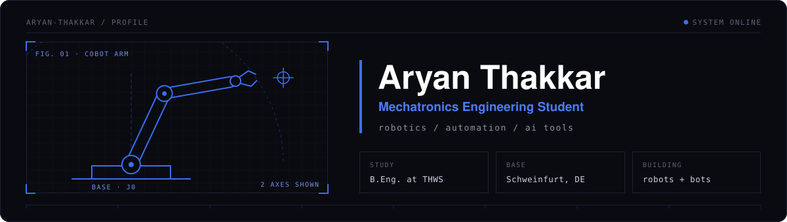

Mechatronics engineering student at THWS in Schweinfurt, Germany. I like building things people can use right away: prototypes, bots and small tools.

**Currently working on:** robot arms and cobots · robot programming · C++ and microcontrollers · machine learning · design of experiments · bots and AI tools

## Projects

| Project | What it is | Built with |
| --- | --- | --- |
| [Servus Brief](https://github.com/aryanthakkar221-droid/servus-brief) | Telegram bot that sends international students in Germany a morning brief: weather, Mensa menu, events, deadlines and a German phrase of the day | Node.js, Telegram Bot API, GitHub Actions |
| [VELOA](https://github.com/aryanthakkar221-droid/Veloa) | Clickable prototype of a support platform for women at universities, built for the Science-Equality-Award at THWS ([live demo](https://veloa-fawn.vercel.app)) | React, JavaScript |
| Caritas-Wegweiser | Voice assistant prototype that routes people to the right Caritas service, built in one day at the InclusivAI Hackathon. I worked on the frontend | Team of 7 |
| [Flash Cards Study Assistant](https://github.com/aryanthakkar221-droid/Java) | Console app to create flash cards and quiz yourself | Java |

## Tech stack

